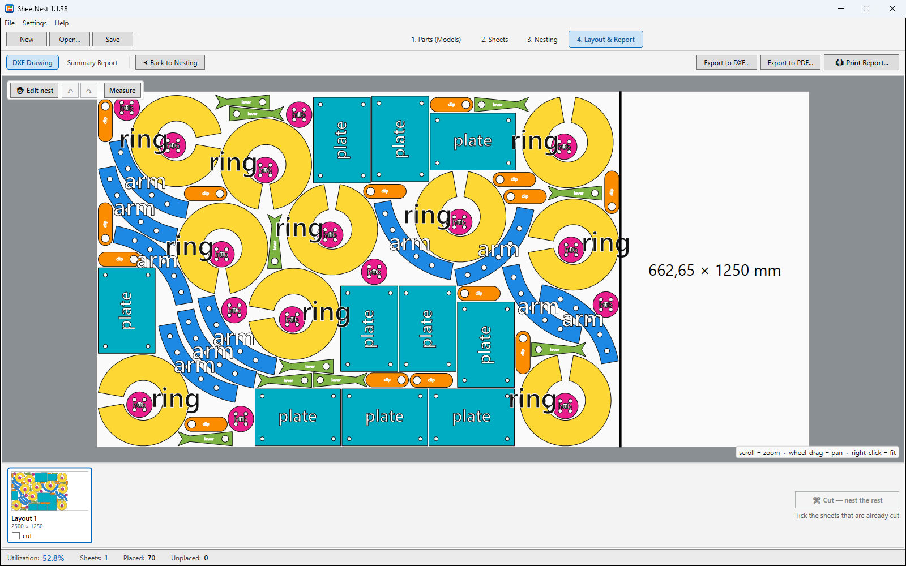
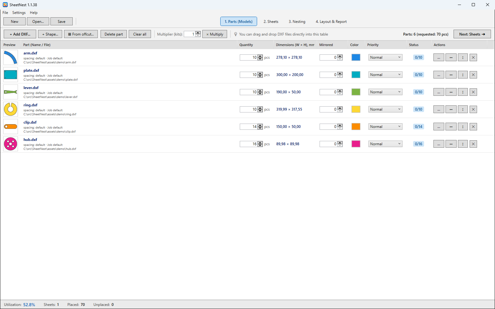
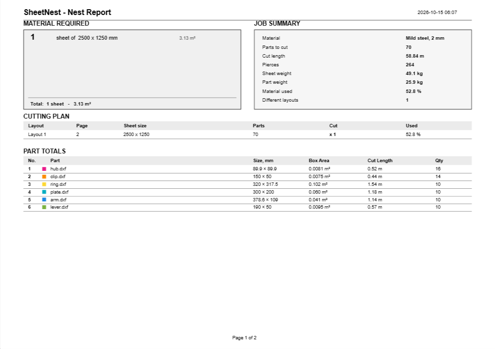
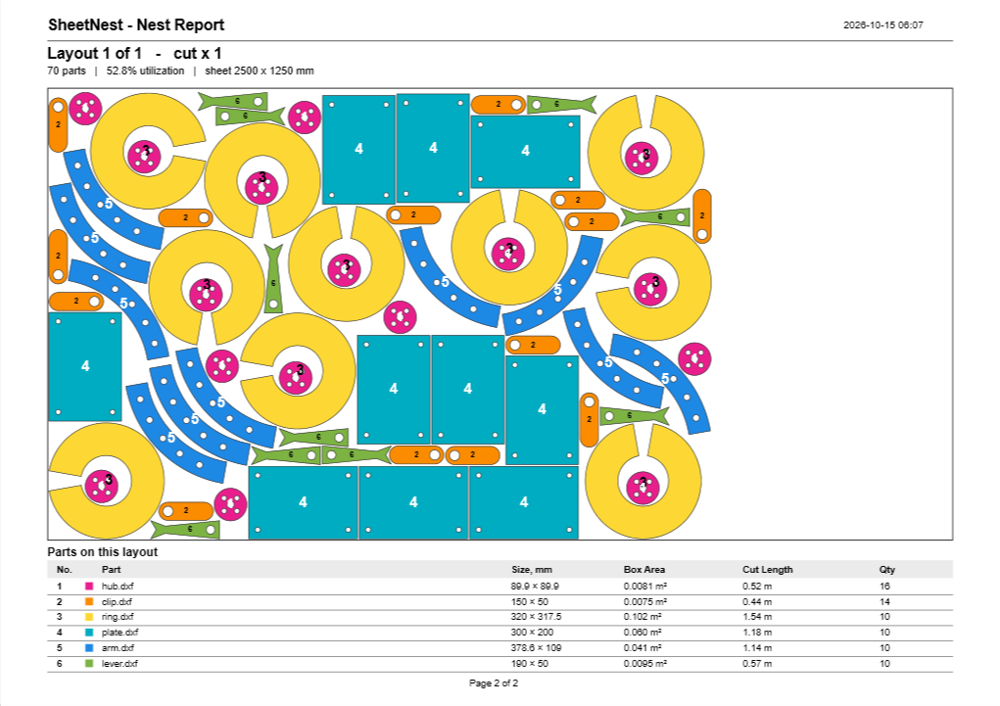

  

  
  

  Free · Windows 10/11, 64-bit · no account, no subscription

# SheetNest: free nesting software for sheet metal

SheetNest is free nesting software for sheet metal fabrication. It fits your parts onto stock sheets for CNC laser cutting and plasma cutting, on Windows, with no account and no subscription.

If you cut sheet metal, SheetNest helps you get the most parts out of every sheet, buy less material, and hand your machine cut-ready files, all from a simple, one-toolbar app.

## About this fork

This is the acvent.bg fork of [ManuelMRosa/SheetNest](https://github.com/ManuelMRosa/SheetNest), developed for and tested at a working laser-cutting shop. It branched from SheetNest 1.1.10; the installer is on the [releases page](https://github.com/vadimkom/ACVSheetNest/releases/latest). It keeps the original's 2D workflow, except that importing and unfolding 3D parts (STEP/IGES through FreeCAD, with the K-factor setting) has been removed. It adds:

**Workflow**
- Four steps across the top: **Parts → Sheets → Nesting → Layout & Report** (Ctrl+1…4).
- Two buttons: **⚡ Draft**, a few-second rough nest for a quote (sheets, area, metres of cut), and **▶ Nest** for the layout you cut. Their search settings live in `%LOCALAPPDATA%\SheetNest\nest-profiles.json`.
- Every press adds a finished nest of the whole job to a list of variants; the best one is starred.
- **Tick sheets as cut, nest the rest**: their parts come off the order and the sheets off the stock.

**Parts and sheets**
- **Flip** a part left/right or top/bottom, and a **Mirrored** quantity column for left/right pairs.
- **Shapes without a DXF**: a rectangle, square, circle, washer or perforated tape in any quantity. Washers M8, M10 and M12 come standard (DIN 125) or wide (DIN 9021), or with any outside and hole. A **perforated tape** blank (length × width, cut into strips of width B with a big hole and four small ones every pitch) is one part: neighbouring strips share one cut along their length, with small bridges so the block leaves the sheet in one piece.
- **Parts library and "what can this offcut make?"** Keep your own parts in a folder (each subfolder a group; DXF parts, plus patterns such as perforated tape saved from + Shape...). **▦ From offcut...** takes an offcut's size and how many of it, and fills it from the groups you tick: the biggest parts first, as many as fit, then smaller ones; patterns are drawn to the offcut's size. The result is a new job, ready to cut. The library folder can be shared between PCs (Advanced Settings).
- A kit **multiplier**.
- **Material and thickness** per job.
- **Sheet priority**: offcuts and remnants are used first and listed first.
- **Offcuts of any shape**: Add sheet → "Sheet from a drawing (DXF, CHF)…" takes the largest contour of a drawing as the sheet's edge and the contours inside it as holes. Parts go only on the metal, keeping the margin from the edge and from the holes; such a sheet is packed with no-fit polygons rather than by the engine (seconds, not minutes), the layout, the report and the sheets table show its real outline, and the DXF carries it on the Background layer.
- Metric sheets by default; the standard sizes stand: 1000 × 2000, 1250 × 2500, 500 × 1250.

**Nesting**
- **Fill-up**: big parts still waiting are offered to each finished sheet before a new one is started. A real three-sheet job now nests on two.
- **Move a part to another sheet** in manual editing, into the first free spot.
- Thumbnails of every sheet.
- Part names drawn on the layout.
- Click a part to see its size and position.

**Import**
- **SC2000 `.chf` drawings**, the whole format. Cut and engraving layers are told apart; the background layer is left out.
- SolidWorks flat patterns: bend lines are kept.
- DXF reading is up to 200× faster on drawings with many holes (a 1393-hole grid took four minutes to open, now seconds).
- Elliptical arcs crossing zero are read correctly.

**Export**
- DXF on three layers your CAM can map: **CUT**, **PAINT** (bend lines and engraved names) and **BACKGROUND**. Cut geometry is written first.
- One DXF per layout: `name_N_WxH_xRepeats.dxf`.

**Report**
- Material, thickness, sheet and part weight, cut length in metres, pierce count and part sizes.
- Unicode PDF, so Cyrillic and other scripts print.
- Works on PCs without native zlib.
- On-screen preview with zoom and direct printing.

**Languages**
- English, Русский, Български, Deutsch, Français, Español, Português, switchable live.
- The texts are standard `.resx` files in `DeepNestSharp/Ui`, so adding a language means adding a file. Corrections from native speakers are welcome.

**Under the hood**
- .NET 10.
- Saved projects about 3× smaller.
- No crash when a project's flash drive has been pulled.
- 3D import (STEP/IGES via FreeCAD) removed: parts come in as DXF or CHF flat patterns, and the installer no longer carries FreeCAD.

Bug fixes that apply to the original are offered back upstream as separate pull requests.

## What SheetNest does

- **Fits the most parts on every sheet, automatically.** True-shape nesting packs your parts tightly by their real outline, so you waste less material and buy fewer sheets. Real 800-part jobs nest in seconds.
- **Imports your DXF part drawings.** Drop in the DXF files you already have and start nesting.
- **Tell it what you need.** Enter how many of each part you want (including mirrored copies), and list the sheet sizes and stock you actually have. Save your own sheet-size presets so they're one click next time.
- **Nest with one click, then fine-tune by hand.** Let SheetNest lay everything out, then drag, rotate, nudge, and drop parts to contact yourself, with spacing kept safe and full undo/redo.
- **Compatible parts can share one cut.** Choose per part whether it may share with any compatible part or only another copy of itself. SheetNest keeps ordinary spacing everywhere else, seats selected straight outside edges at the configurable Common Line Gap, and exports each cluster as a closed outer boundary plus one midpoint seam on clearly named layers your CAM can read.
- **Picks the best sheet size for you.** Stock several sizes and SheetNest puts the bulk on the size that packs densest and the leftovers on the size that wastes least. Standard US sheet sizes are built in, plus your own custom sizes.
- **Exports cut-ready DXF.** One clean DXF per layout, parts only, so your CAM software has nothing extra to trip over. Identical sheets are grouped into a simple "cut N of this layout" plan.
- **One-click PDF report.** A purchasing-ready report showing how much material to buy (sheets per size and total area), the cutting plan, part totals, and a scaled drawing of each layout.
- **Works in inches or millimeters.** Switch units to match your shop, with sheets up to 6000 × 2000 mm.
- **Keeps your work safe.** Autosave and crash recovery, a backup copy on every save, a Recent Projects list, and double-click a project file to open it right where you left off. Each saved project remembers its own sheet stock and its finished nest.
- **Free and open.** No account, no subscription, no license key. Open-source software you can just use.

## Screenshots

The pictures show a made-up demo job: an arm, a plate, a lever, a ring, a clip and a hub on a 2500 × 1250 mm sheet. The drawings are in [assets/demo](assets/demo), so the shots can be taken again.

   
  <em>One-click true-shape nesting: the hubs go into the rings' holes, the leftover strip is offered as an offcut, and every sheet has a thumbnail to tick when it is cut.</em>

   
  <em>The parts: quantities and mirrored copies in the row, each part's colour and priority, flip buttons, shapes without a DXF and filling an offcut from the library.</em>

   
  <em>Fine-tune by hand: select, drag, rotate, mirror, nudge, or move a part to another sheet.</em>

   
  <em>The one-click PDF report: how much material to buy, what it weighs, metres of cut and pierces, the cutting plan, and every part with its size.</em>

   
  <em>Every layout drawn to scale, with each part numbered so a cut piece can be matched to its row.</em>

## License

SheetNest is open-source software released under the MIT License. See [LICENSE](LICENSE).

SheetNest bundles the open-source sparrow nesting engine (MIT) with the jagua-rs geometry library (MPL-2.0) compiled in. See [THIRD_PARTY_NOTICES.md](THIRD_PARTY_NOTICES.md) for licenses and sources.

Building from source? See [BUILDING.md](BUILDING.md).
